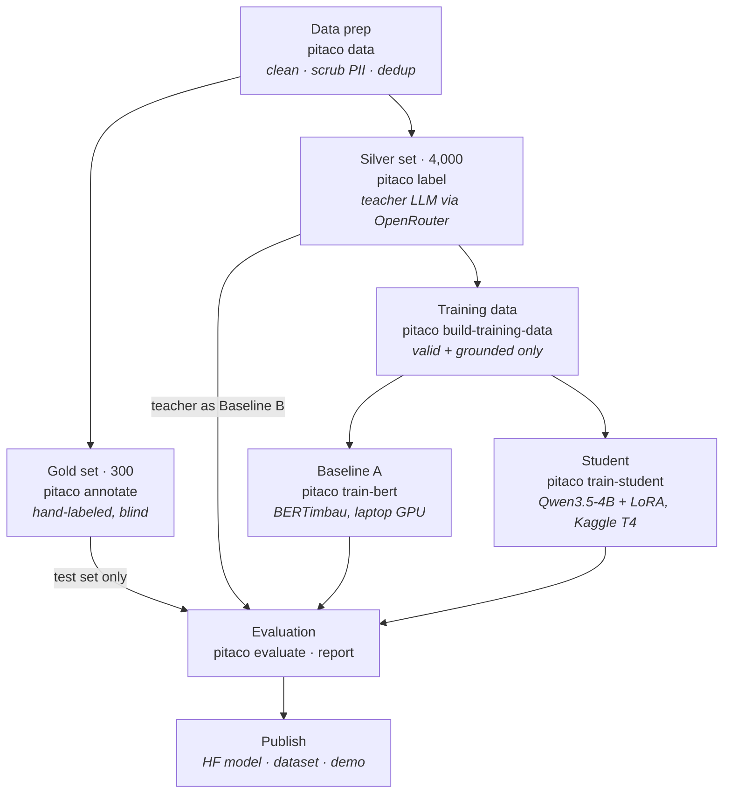
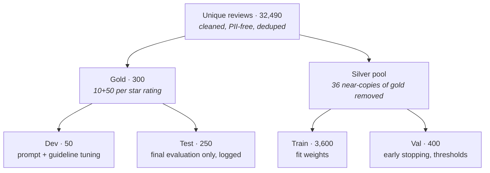
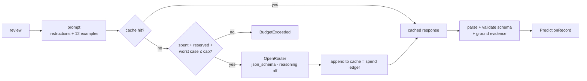

# Architecture

## Pipeline

Every box is one CLI command (`pitaco <stage>`), chained by the Makefile.

## Splits and the leakage guard

Enforced in code: `assert_no_leakage` (no shared id, no identical normalized text, no fuzzy ratio ≥ 90
between gold and silver), few-shot examples must come from silver (`check_fewshot_not_in_gold`), and
every evaluation on gold test is appended to `results/test_access.log`.

## Labeling loop (teacher)

## One prediction format

Teacher, Claude, BERTimbau and student all write `results/predictions/<system>/<split>.jsonl`
(`PredictionRecord`: parsed analysis or label-only mentions, validity, grounding, latency, cost),
so `pitaco evaluate` scores every system the same way and `pitaco report` builds one table.
